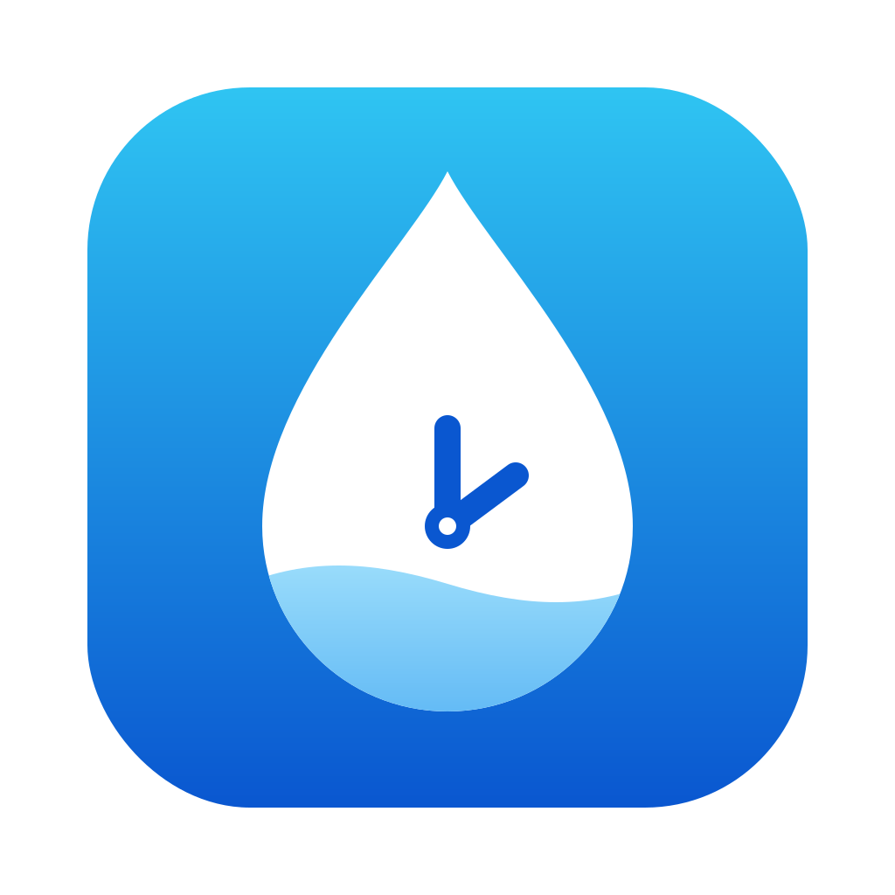

<p align="center"></p>

# Hourdrop

A Mac menu bar app that reminds you to drink water, and lets you log it straight from the reminder. It works with any bottle, glass or cup, and also tracks coffee, chai and smoothies. Its reminders are smart: they follow your pace, wait while you're on a call or away, and finish with an end-of-day recap. No Xcode needed.

*(Hourdrop used to be called Sip. Updating keeps your drinks and settings.)*

## Install (about 2 minutes)
1. Get the code: on GitHub click **Code → Download ZIP** and unzip it, or run `git clone https://github.com/AryanVarmora/Sip.git`.
2. Open **Terminal**, go into the folder and run the installer:
   ```
   cd ~/Downloads/Sip-main      # or wherever the folder is
   bash install.sh
   ```
3. First time only: if a popup asks to install **Command Line Tools**, click **Install**, wait for it to finish, then run `bash install.sh` again.
4. Hourdrop opens. A drop and `0.0 L` appear in your menu bar.
5. Click **Allow** when macOS asks about notifications.

`Hourdrop.app` is now in **/Applications** like any other app. You can open it from Launchpad or Spotlight (⌘Space → "Hourdrop").

## Set up (one time)
1. Click the drop → **Settings…**
   - **Water** tab:
     - **I drink from**: a bottle, or a glass or cup.
     - **Size**: type the exact ml (ounces show next to it), or pick one from **Common sizes**.
     - **Daily goal**.
     - **Water filter**: leave it on **None** if you don't have one. If your bottle or pitcher has a filter, pick **LARQ**, **LARQ Advanced**, or **Other filter** (enter how many liters and/or months it lasts), then set **Put in on** to the day you installed it.
   - **Reminders** tab: pick how often (**30 minutes, 1 hour, 1½ hours or 2 hours**) and your **wake hours**. Reminders only come inside them, and they can run past midnight, e.g. From 10 AM Until 2 AM. Click **Send a test reminder** to check it works.
   - **General** tab: turn on **Launch at login** so Hourdrop starts every time your Mac boots.
2. System Settings → **Notifications → Hourdrop**:
   - Alert style: **Alerts**. They stay on screen until you tap a button; Banners vanish and you miss the log.
   - If macOS asks about Hourdrop in **Login Items**, allow it.

## Daily use
- About every 30 minutes a reminder appears. Have a drink, then hover it → **Options** → pick how much you drank: **¼, ½ or a full bottle** (or glass). The ml amount is shown. Logged.
- Or click the drop in the menu bar and tap ¼ / ½ / Full, or press **⌃⌥W** (Control-Option-W) in any app to log ¼ without clicking.
- **Coffee, chai or a smoothie?** Click the drop, tap ☕️ Coffee, 🍵 Chai or 🥤 Smoothie, then pick a size: **10, 12, 16, 20, 24 or 30 oz**. For anything else, type it next to **Other** (e.g. 18) and click **Log**.
- From a reminder: **Options → ☕️ Coffee…** (or Chai… / Smoothie…), type the ounces (e.g. 30), then click **Log**. You can also type ml, like "355 ml".
- Every drink counts toward your daily goal. Under the total you'll see the split, e.g. 💧 1.3 L ☕️ 0.4 L.
- Tapped the wrong one? **Undo last** removes it.
- The menu bar always shows today's total. It resets at midnight.
- Your full history is saved in `~/Library/Application Support/Hourdrop/water-log.json`.

## Smart features
Each one can be turned off in Settings.
- **Pace**: the bar in the menu bar popover has a line showing where you'd be by now if you drank evenly through your wake hours. Under it: **On track**, **Behind by 300 ml** or **Ahead by 500 ml**.
- **Reminders that adjust** (Settings → Reminders):
  - Logging any drink restarts the clock, so you're never reminded right after drinking.
  - When you're ahead of pace, reminders come half as often. When you're behind, a bit more often.
  - **Wait while I'm busy**: no reminders during a call (any app using a microphone), when you've been away from the Mac for 5+ minutes, or when the screen is locked. You get one reminder when you're back, not a pile.
  - **End-of-day recap**: when your wake hours end, a summary like "Today: 3.2 L of 4.0 L · ☕️ 2 coffees · ~190 mg caffeine".
- **Filter reminders** (Settings → Water, if your bottle or pitcher has a filter): Hourdrop counts the water you log toward the filter's limit. LARQ filters last 94 L (Advanced: 151 L) or 2 months; for any other filter you enter the liters and/or months.
  - At 90% you get a heads-up.
  - Once it's due, you get a "Time to change your filter" reminder **every morning until you change it**.
  - After swapping it, click **Replaced it ✓**: on the reminder, in the menu bar popover (it shows from 90%), or in Settings. Counting restarts from that day.
- **Caffeine** (Settings → General): the popover shows today's estimated caffeine (coffee ≈ 95 mg per 8 oz, chai ≈ 50 mg). Coffee or chai after 2 PM (you can change the time) gets one heads-up per day that it may affect your sleep.
- **Keyboard shortcut** (Settings → General): **⌃⌥W** logs ¼ from any app, or set it to ½ or a full bottle.

## Updating
Change any file in `Sources/`, then run `bash install.sh` again. It rebuilds and replaces the installed app.

## Changing the icon
The icon is `Icon/AppIcon.icon`: the Hourdrop drop with clock hands, using macOS's glass style. `Icon/Hourdrop-logo.png` is the flat original artwork.
1. Double-click `Icon/AppIcon.icon` to open it in **Icon Composer** (comes with Xcode).
2. Change colours, glass or layers, then save.
3. Run `bash install.sh`. It rebuilds the icon and saves a ready-made copy in `Resources/`, so the install still works on Macs without Xcode.

If the old icon still shows in Finder or Launchpad, run `killall Dock` to refresh the icon cache.

## Uninstall
Quit Hourdrop from its menu, delete `/Applications/Hourdrop.app`, and optionally delete `~/Library/Application Support/Hourdrop`.

## Troubleshooting
- **No notifications**: check Focus / Do Not Disturb is off, and System Settings → Notifications → Hourdrop is allowed.
- **No permission prompt**: remove Hourdrop from System Settings → Notifications, then reopen Hourdrop.
- **Doesn't start at login after updating from Sip**: in Settings → General, turn **Launch at login** off and on again.
- **"Apple could not verify Hourdrop…" warning**: `install.sh` already removes the downloaded-file mark that causes it. If it still appears, open System Settings → Privacy & Security, scroll down and click **Open Anyway**. If you send `Hourdrop.app` to someone else, they will see this warning. Only a paid Apple Developer account ($99/year) with notarization removes it on other Macs.
- **Build error**: copy the Terminal output and open an issue.

## Files
| File | What it does |
|---|---|
| `install.sh` | Builds the app and icon, signs it locally, installs to /Applications, launches it |
| `Info.plist` | App identity and icon; `LSUIElement` makes it menu bar only (no Dock icon) |
| `Icon/AppIcon.icon` | The app icon source (open in Icon Composer) |
| `Icon/Hourdrop-logo.png` | The flat logo artwork |
| `Resources/` | Built icon files (`AppIcon.icns`, `Assets.car`), made by `install.sh` |
| `Sources/HourdropApp.swift` | App entry, menu bar icon + live total, keyboard shortcut action |
| `Sources/WaterStore.swift` | Drink types, sizes and caffeine; saves drinks, totals, undo, midnight reset |
| `Sources/NotificationManager.swift` | Once-a-minute check that sends reminders, the recap, filter and caffeine alerts; reminder buttons that log drinks |
| `Sources/Pace.swift` | Wake hours, pace (ahead / on track / behind) and when the next reminder is due |
| `Sources/Presence.swift` | "Busy?" check: screen locked, away from the Mac, or a mic in use |
| `Sources/Filter.swift` | Water filter choices and filter life (liters or months) |
| `Sources/HotKey.swift` | The ⌃⌥W keyboard shortcut |
| `Sources/Prefs.swift` | Every saved setting and its default, plus upgrades from older versions |
| `Sources/Format.swift` | Formatting for liters, ounces, ml and hours |
| `Sources/MenuBarView.swift` | Popover: progress with pace, logging, caffeine, filter status, today's log |
| `Sources/SettingsView.swift` | Settings tabs: Water, Reminders, General |
